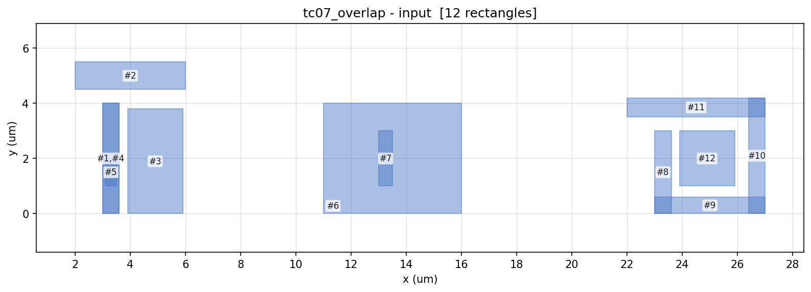

# Project 2 — End-of-Line (EOL) DRC Checker

Reads a layout in the project-1 format, finds end-of-line spacing violations on every layer,
and reports where they are.

## Quick start

```bash
make          # build ./eol_drc (C++17, no external libraries)
make run      # check the layout given in the spec and print the result
make test     # run all testcases and compare with the expected results
make figures  # after make test: draw the results with checked regions into output/*.png
              # (needs Python matplotlib)
```

Check any layout file:

```bash
./eol_drc <layout_file> [result_file]
```

Result for the layout given in the spec: one violation per line, as `layer  x1 y1,  x2 y2`
(lower-left and upper-right corner, um).

```
number_of_violations 3
1  6.100 1.000,  7.000 1.600
1  6.100 1.000,  7.000 1.600
1  10.000 1.800,  11.400 2.200
end_of_violation
```

The first two lines are the same gap seen from both line ends (#2 and #4 face each other),
so they are two violations.

## Example (tc07)

Input:



Output with the regions the checker looked at:


- **Orange line**: EOL edge.
- **Purple box**: EOL spacing region in front of the edge (checked): EOLSpacing 1.0 deep,
  EOLWithin 0.4 wider on each side.
- **Red box**: violation.

## How it works

Rule parameters (`src/eol_rule.h`):

| Parameter | Value |
|---|---|
| EOL edge length (length of end) | <= 0.6 um |
| EOLSpacing: depth of the EOL spacing region | 1.0 um |
| EOLWithin ("halo"): extra width of the EOL spacing region on each side | 0.4 um (assumed; no value in the spec) |

The spec's parallel length (0.7) and parallel halo (0.4) are not used: every EOL edge is checked,
with or without metal beside it.

1. Read the layout. Convert coordinates to integer nm, so there are no floating-point errors.
   Overlapping or touching rectangles on the same layer count as one piece of metal.
2. Find every EOL edge: an end of the metal no longer than 0.6 um.
3. Check the EOL spacing region in front of every EOL edge.
4. Report a violation if the EOL spacing region has metal. Metal that only touches its border
   is legal. Each EOL edge counts as one violation, seen from that edge: two line ends facing
   each other are two violations; one end with several metals in front is one violation.

A grid spatial index keeps every search local (1,000,000 rectangles take about 1.7 s).
All four directions use the same code: the layout is rotated by 90 degrees each time.

## Directory

```
.
├── Makefile
├── src/                  C++ source
│   ├── main.cpp          entry point
│   ├── layout.*          data structures + input parser
│   ├── eol_rule.h        rule parameters
│   ├── eol_checker.*     EOL checking algorithm
│   └── report.*          result writer
├── testcases/
│   ├── inputs/           test layouts (tc00_sample = the layout in the spec)
│   ├── expected/         expected results
│   ├── figures/          pictures of every testcase
│   └── README.md         what each testcase checks
├── scripts/              test runner and drawing scripts
└── docs/                 pictures (README examples, flowchart, result on the spec's layout)
```
