# Project 2 報告：End-of-Line (EOL) 規則檢查

姓名：＿＿＿＿　學號：＿＿＿＿

---

## 1. EOL 規則說明與背景

### 1.1 背景

在先進製程中，金屬線的線端（end of line）在微影製作時容易變形，例如變圓或縮短。兩條線端如果靠得太近，容易造成短路或良率下降。因此設計規則會要求線端前方保留比一般間距更大的空間，這就是 **EOL spacing rule**。

這條規則在 TSMC、Intel、Samsung 的先進節點都很重要。繞線器（例如 UCSD 的 TritonRoute [1]）在 DRC 檢查時必須遵守它，遇到違規就要另找繞線路徑。

### 1.2 規則內容

> **圖 1**：作業提供的 EOL 規則示意圖（請從作業文件複製）。object 3 落在平行區域內時，object 1 與 object 2 之間需要滿足 EOL spacing。
>
> **圖 2**：TritonRoute [1] 的 EOL spacing 示意圖 Fig. 2(a)（請從作業文件複製）。粉紅色為 EOL spacing 區域：線端前方 EOLSpacing，左右各比線端寬 EOLWithin。

一條金屬線的末端要**同時**滿足下面三個條件，才算 EOL violation：

1. **是線端**：末端的邊長 ≤ 0.6 µm。
2. **旁邊有金屬**：在線端兩側往外 0.4 µm、從線端往回 0.7 µm 的範圍內，至少一側有其他金屬，也就是圖 1 的 object 3。
3. **前方太近**：EOL spacing 區域內有其他金屬。這個區域在線端前方 EOLSpacing（1.0 µm），左右各比線端寬 EOLWithin（0.4 µm）。

| 作業用語 | 論文 / LEF 用語 | 數值 | 來源 |
|---|---|---|---|
| Length of end | eolWidth | ≤ 0.6 µm | 作業給定 |
| EOL spacing | eolSpace | 1.0 µm | 作業給定 |
| Parallel length | parWithin | 0.7 µm | 作業給定 |
| Parallel halo | parSpace | 0.4 µm | 作業給定 |
| Halo | eolWithin | 0.4 µm | **假設**（作業未給數值） |

### 1.3 判定假設

作業文件沒有說明清楚的地方，本作業採用以下假設：

- **eolWithin = 0.4 µm**：作業沒有給 halo（eolWithin）的數值。圖 1 裡 halo 的寬度看起來和 parallel halo 差不多，所以假設是 0.4 µm。
- **平行區域含邊界**：距離剛好 0.4 µm 也算在平行區域內。作業範例中 #1 和 #2 剛好相距 0.4 µm。
- **Violation region 的邊界不算違規**：間距剛好 1.0 µm，或橫向剛好在 0.4 µm 外，都合法。這和作業寫的 "at least 1" 一致。
- **矩形合併**：同一層重疊或相接的矩形視為同一塊金屬。
- **分層**：只有同一層的金屬會互相影響。

---

## 2. 演算法

### 2.1 流程圖

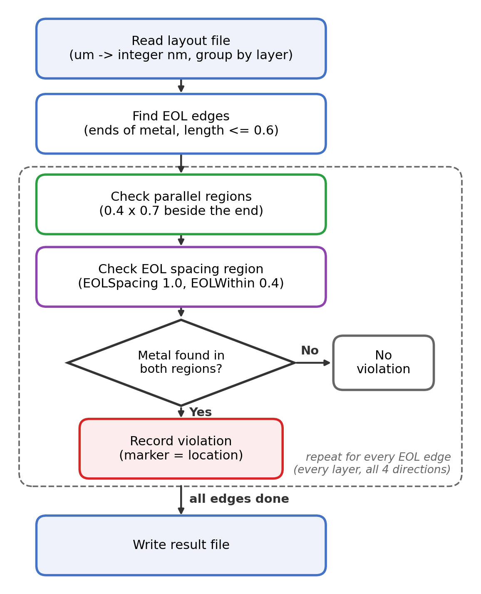

**圖 3**：演算法流程圖

### 2.2 步驟說明

1. **讀取 layout**：解析輸入檔，把座標從 µm 轉成整數（nm），再依金屬層分組。用整數計算可以避免浮點誤差，例如 2.3 − 1.3 用浮點數會算出 0.9999999999999998。
2. **找出 EOL 邊**：從每個矩形的端點出發，先把相接的矩形接成同一條邊。這條邊的長度 ≤ 0.6 µm，而且兩端都是凸角（線真的在這裡結束），就是一條 EOL 邊。
3. **檢查平行區域**：看 EOL 邊兩側的平行區域（0.4 × 0.7 µm）裡有沒有金屬。
4. **檢查 EOL spacing 區域**：看 EOL 邊前方的 EOL spacing 區域（EOLSpacing 1.0 µm、左右各寬 EOLWithin 0.4 µm）裡有沒有金屬。
5. **判斷違規**：兩個區域都有金屬才算違規。
   - EOL spacing 區域裡的每塊金屬各記一個 violation，位置是 EOL 邊到這塊金屬之間的區域。
   - 只有其中一個區域有金屬不算違規，但兩個區域都會畫在圖上。
6. **輸出結果**：兩個線端互相面對時，同一個 violation 會從兩端各被找到一次，所以輸出前先去掉重複，再寫入結果檔。

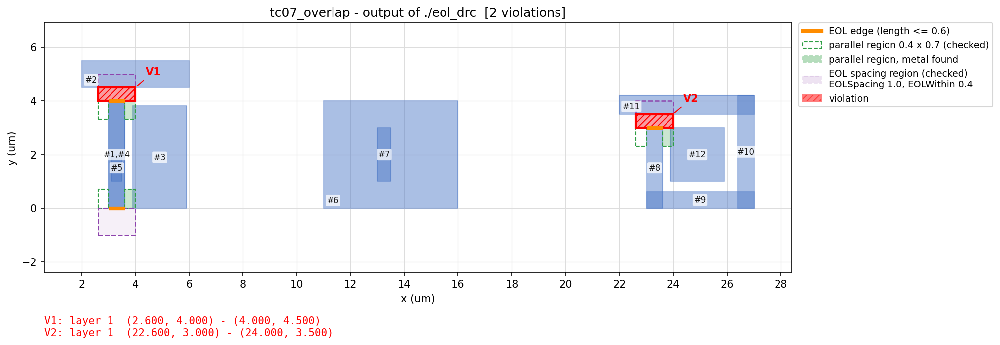

**圖 4**：檢查區域示意（測資 tc07）。
- 橘色：EOL 邊。
- 綠色：檢查的平行區域，填色表示在這裡找到金屬。
- 紫色：檢查的 EOL spacing 區域（EOLSpacing 1.0、EOLWithin 0.4）。
- 紅色：violation。

### 2.3 實作重點

- **四個方向共用同一段程式**：程式只處理朝上的 EOL 邊。其他三個方向就把整層旋轉 90°、180°、270°，套用同一段程式後再把結果轉回原座標。
- **空間索引**：把平面切成均勻的格子，每個矩形登記在它蓋到的格子裡。查詢一個區域時只看附近格子裡的矩形，不用把所有矩形兩兩比較（O(n²)）。
- **效能**（隨機產生的 layout，Apple M 系列筆電）：

| 矩形數 | 執行時間 |
|---:|---:|
| 10,000 | 0.02 秒 |
| 100,000 | 0.13 秒 |
| 1,000,000 | 1.7 秒 |

---

## 3. 結果

### 3.1 作業範例

輸入是作業提供的 6 個矩形，程式輸出如下：

```
number_of_violations 2
1  6.100 1.000,  7.000 1.600
1  10.000 1.800,  11.400 2.200
end_of_violation
```

每一行代表一個 violation，格式是 `層  左下角 x y,  右上角 x y`，單位 µm。

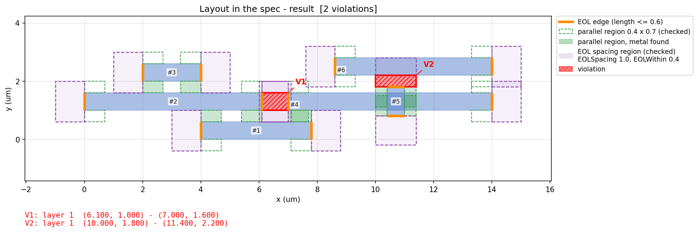

**圖 5**：作業範例的檢查結果

| | 位置 (µm) | 原因 |
|---|---|---|
| V1 | (6.1, 1.0) – (7.0, 1.6) | #2 右端和 #4 左端相距 0.9 µm，小於 1.0。#1 在兩個線端下方 0.4 µm 處，滿足平行條件。 |
| V2 | (10.0, 1.8) – (11.4, 2.2) | #5 上端（寬 0.6）和 #6 相距 0.4 µm，小於 1.0。#4 就在 #5 兩側，滿足平行條件。 |

其他線端都沒有違規，原因是兩者之一：
- 不滿足平行條件。
- 前方區域裡沒有金屬。例如 #2 和 #1、#3 都剛好相距 0.4 µm，只碰到 EOL spacing 區域的邊界，不算違規。

### 3.2 測資驗證

除了作業範例，我另外設計了 9 組測資。每組都和事先推導的標準答案比對，全部通過。

| 測資 | 測試內容 | 違規數 | 結果 |
|---|---|---:|---|
| tc00_sample | 作業範例 | 2 | 通過 |
| tc01_basic | 基本情況：線端前方 0.5 有金屬，旁邊有鄰居 | 1 | 通過 |
| tc02_parallel_cond | 平行條件：沒有鄰居、鄰居太遠、鄰居太短都不檢查 | 2 | 通過 |
| tc03_space_width | 間距剛好 1.0 合法、線寬 0.7 不是線端、金屬只擋到一部分 | 3 | 通過 |
| tc04_directions | 上、下、左、右四個方向 | 4 | 通過 |
| tc05_multilayer | 不同層的金屬互不影響 | 1 | 通過 |
| tc06_merge | 多個矩形接成的線，接縫不算線端 | 2 | 通過 |
| tc07_overlap | 重複或包含的矩形；鉤子形狀（線端對著自己） | 2 | 通過 |
| tc08_float | 浮點誤差陷阱 | 2 | 通過 |
| tc09_eol_within | EOLWithin：從旁邊伸進來、在斜前方的金屬 | 2 | 通過 |
| tc90_random_10k | 隨機 10,000 個矩形（測速度，沒有標準答案） | 3335 | 0.03 秒 |

**各測資的程式輸出：**

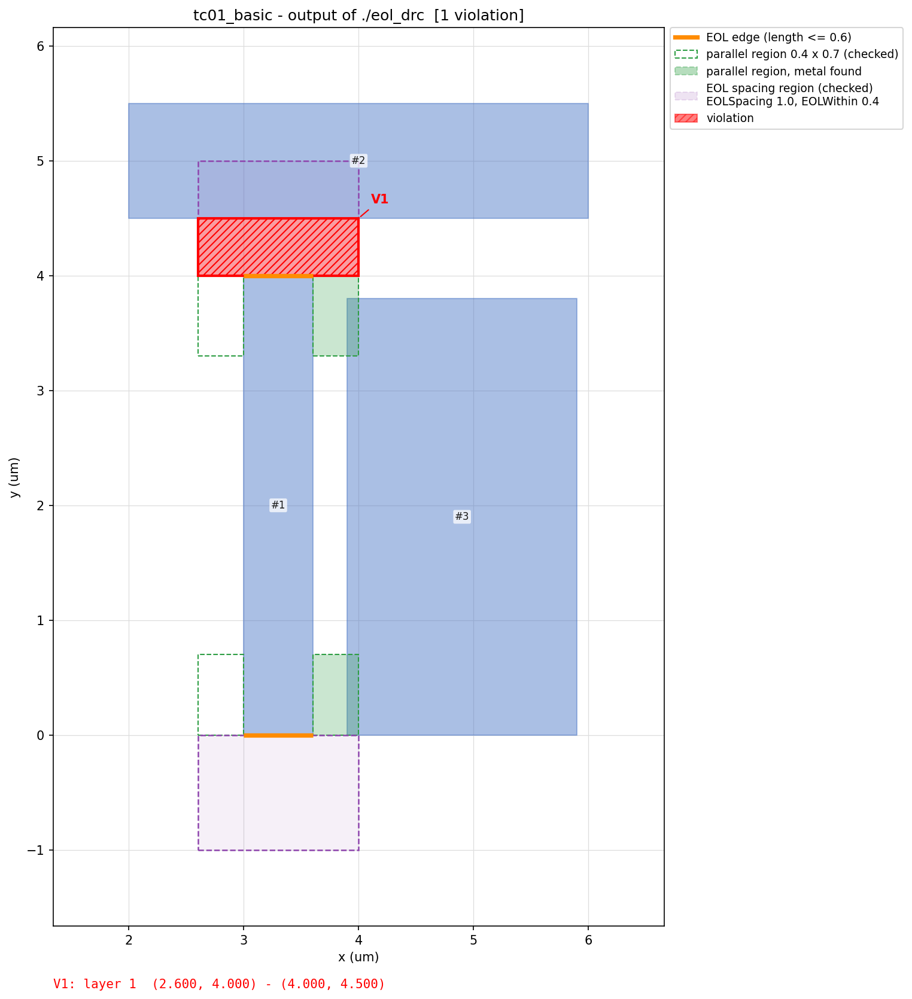
**圖 6**：tc01，基本情況。

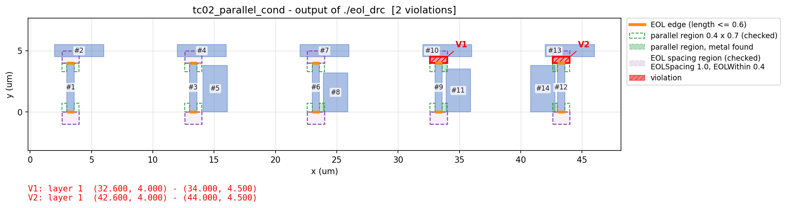
**圖 7**：tc02，平行條件。左邊三組旁邊沒有金屬，所以前方雖然太近，也不算違規。

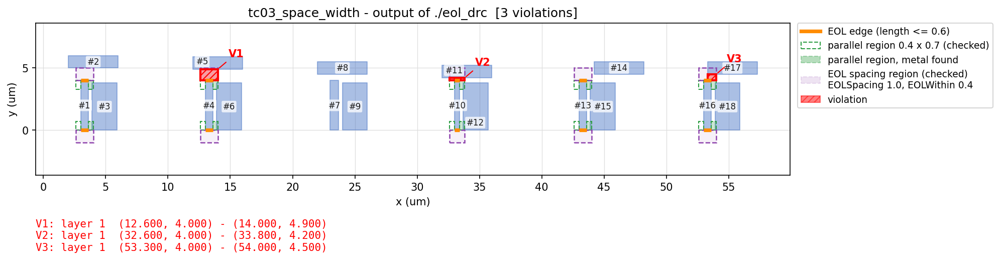
**圖 8**：tc03，間距與線寬的邊界情況。

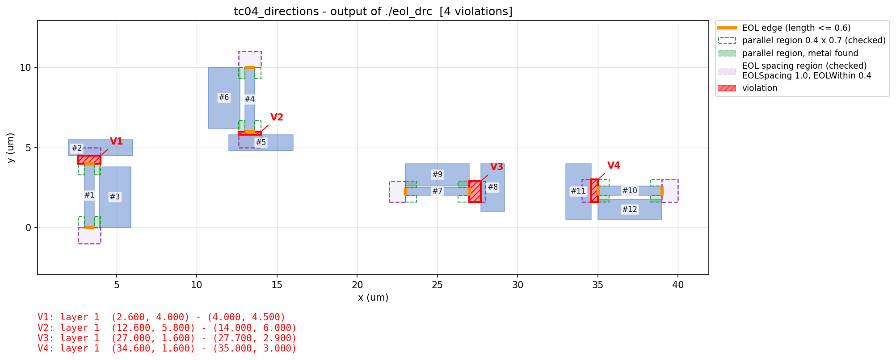
**圖 9**：tc04，四個方向。

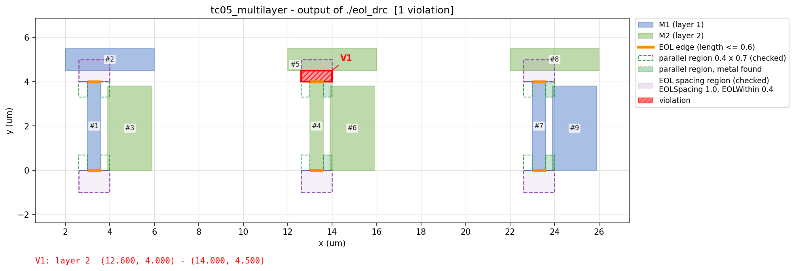
**圖 10**：tc05，兩層金屬。只有全部在 M2 的那組違規。

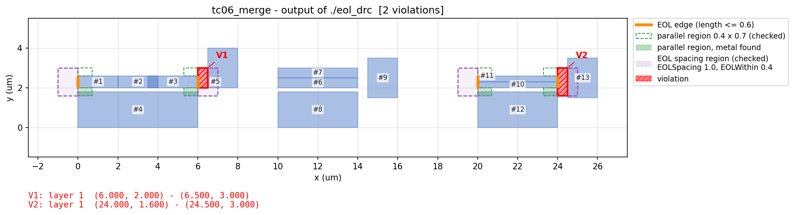
**圖 11**：tc06，矩形合併。接縫不算線端，只有真正的線端被檢查。


**圖 12**：tc07，重疊、包含與鉤子形狀。

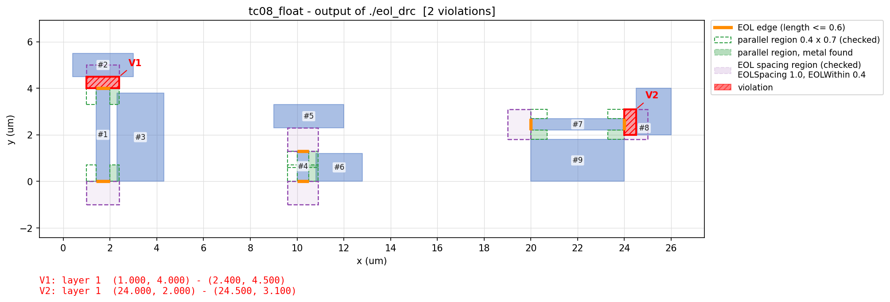
**圖 13**：tc08，浮點誤差陷阱。

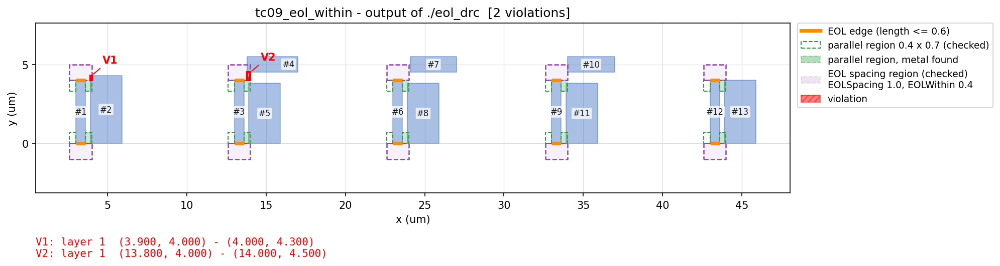
**圖 14**：tc09，EOLWithin 範圍（線端左右兩側）。

---

## 4. 程式位置與執行方式

- GitHub：https://github.com/CalvinKuan/DA_HW2
- 伺服器路徑：＿＿＿＿（助教登入後的位置）

```bash
make          # 編譯
make run      # 檢查作業範例並輸出結果
make test     # 執行所有測資並比對答案
```

詳細說明請見目錄中的 README.md。

---

## 參考資料

[1] UCSD TritonRoute 論文，https://vlsicad.ucsd.edu/Publications/Journals/j133.pdf
